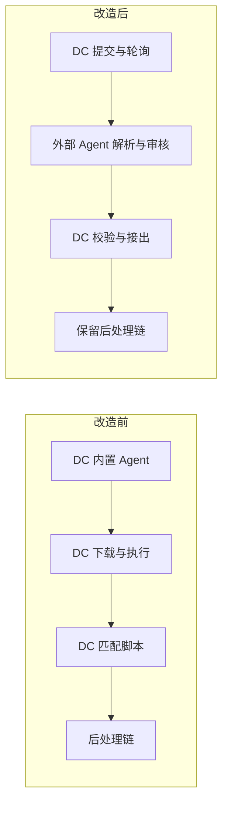
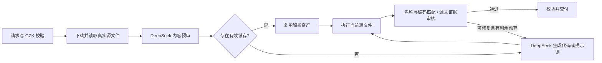

# EDB-match-Agent

**基于 DeepSeek 的经济指标解析与匹配 Agent：支持 Excel、HTML 与 Markdown Prompt，提供 CLI、HTTP 服务及 DC 工作流接入。**

针对统计文件结构不统一、人工编写解析规则成本高的问题，根据当前源文件、规则库及 Skill 生成 Python 解析代码或提取提示词，执行提取、指标匹配和独立源文审核。业务判断及修复使用用户配置的 DeepSeek / OpenAI 兼容 API，Python 负责调度、执行和校验。

技术栈：Python · DeepSeek · Prompt Engineering · Skill · HTTP API · SQLite · OpenPyXL · xlrd

## DC 工作流改造前后对比

将原先在 DC 内完成的代码生成、下载解析、指标匹配与名称审核迁入外部 Agent；DC 保留规则库查询和原有单位换算、清洗、内审及标注链。

| 对比项 | 原 DC 方案 | 外部 Agent 方案 |
| --- | --- | --- |
| 节点 / 连线 | 47 / 59 | 45 / 60 |
| 生成、执行与匹配 | 分散在 DC Agent、执行和匹配节点 | 外部服务统一生成、执行、匹配及证据审核 |
| DC 接入方式 | 多分支各自维护解析逻辑 | 3 个分支接入、1 个成功判断、2 个接出节点 |
| 后处理 | 单位换算、清洗、内审、标注 | 保留原业务逻辑，通过接出字段适配衔接 |
| 规则迭代与资产复用 | 与节点脚本耦合 | 服务侧规则与 Skill 集中维护，同路径资产缓存减少重复生成 Token |



数量来自提供的两版工作流快照，非实时平台读取；逐职责变更清单、完整数据流、HTTP 契约与设计决策见 **[DC 工作流改造对比](docs/DC工作流改造对比.md)**。

## 工作流程



- **三种解析分支**：Excel 读取原始工作簿；HTML 根据 Markdown 和名称正则生成 Python；Prompt 生成可复用提示词并调用模型提取。
- **质量闭环**：无有效 GZK 时停止；真实正文预审后再生成；核对源值、指标身份、遗漏及统计期间，首次生成加最多两次重建。证据不足不武断判为无数据。
- **同路径资产缓存**：按数据源路径归组，结合规则、GZK 和 Skill 内容校验有效性；复用已审核代码或提示词，减少重复生成的 Token 成本。当前文件仍需执行和审核，Prompt 的模型提取仍会消耗 Token。
- **异步任务服务**：HTTP 受理、SQLite 持久化、幂等提交和同任务轮询；具体错误码、中文原因及处理建议直达工作流。
- **完整交付**：审核通过的资产校验 SHA256；在结果传输中提供 Base64 备份，兼容 DC 丢失独立代码字段的场景，恢复后仍严格校验哈希。

## 三种分支与输出

| 分支 | 源输入 | 资产 | HTTP `result` 的业务字段 |
| --- | --- | --- | --- |
| `excel` | `fileMd5` 原文件或 CLI 本地 Excel/CSV | 完整平台 Python | `OUTDATA`、`unitArray`、`codeOutputResult`、`excel_data` |
| `html` | `markdownMD5` 正文，生成期核对原网页 | 完整平台 Python | `OUTDATA`、`unitArray`、`codeOutputResult`、`excel_data` |
| `prompt` | `markdownMD5` 对应的已转换正文 | Markdown 提示词 | `OUTDATA` |

HTTP 服务按真实 `fileType` 选择分支。`html/htm/shtml` 进入 HTML，`xls/xlsx/csv` 进入 Excel，`pdf/doc/docx/md/txt/png/jpg` 等进入 Prompt。不要把 `fileType` 填成 `prompt`；Prompt 不负责 OCR 或文档转换，需要上游先提供可用 Markdown。

`excel_data` 是最终审核通过轮次的原始四字段明细，保留原始数值和单位；`OUTDATA` 是匹配结果。实际单位换算由下游完成，避免重复换算。统计截止日期不能由 `publictime` 代替。

> CLI 的 `node-output.json` 保持原业务契约：Excel/HTML 三字段，Prompt 仅 `OUTDATA`。HTTP 额外交付 Excel/HTML 原始明细，并附传输专用 `_asset_transfer`；最新版接出脚本校验、移除传输字段后再输出业务结果。

## 安装

需要 Python 3.10+，推荐从仓库完整克隆或下载后运行：

```powershell
python -m venv .venv
& .\.venv\Scripts\python.exe -m pip install -e ".[xls]"
Copy-Item .env.example .env
```

在本机 `.env` 填写 `DEEPSEEK_API_KEY`、实际支持的 `DEEPSEEK_BASE_URL` 和 `DEEPSEEK_MODEL`。模型凭据不会提供给解析子进程；不要将 `.env` 提交到 Git。Linux/macOS 使用 `.venv/bin/python`。

真实规则库和源数据放 `private/`，不随仓库分发。示例下载地址 `example.invalid` 不可用，必须替换。规则文件和 Skill 的相对路径以任务配置文件所在目录为基准。

## CLI 运行

分别使用 [Excel](examples/excel-job.json)、[HTML](examples/html-job.json)、[Prompt](examples/prompt-job.json) 模板，填写自己的规则表、下载地址及本次输入。每次任务必须提供有效 `GZKJG`。

```powershell
& .\.venv\Scripts\python.exe -m excel_match_agent run --job examples/excel-job.json --diagnostics
```

无需真实业务文件的合成样例见 `examples/job.local.json`、`examples/prompt.local.json`；运行这些样例仍会调用实际模型，不属于离线测试。

## 启动 HTTP 服务

```powershell
& .\.venv\Scripts\python.exe -m excel_match_agent.service init-config
# 编辑生成的 excel_match_agent/service-runtime/config.json：
# 核对 profiles 指向的三分支任务配置；按部署环境设置 host 和端口。
& .\.venv\Scripts\python.exe -m excel_match_agent.service check-config
& .\.venv\Scripts\python.exe -m excel_match_agent.service serve
```

默认仅监听 `127.0.0.1:8767`；DC 运行在其他机器时需显式配置可达地址及相应网络权限。`api_token` 是独立服务令牌，不是 DeepSeek Key。不要把 `config.json` 或令牌上传到仓库。

| 方法与路径 | 作用 |
| --- | --- |
| `GET /health` | 无需认证的健康检查 |
| `POST /v1/match/jobs` | 受理任务，返回 `job_id`；需 Bearer 服务令牌 |
| `GET /v1/match/jobs/{job_id}` | 查询同一任务；支持 `wait_seconds=0..25` |

DC 使用 [接入脚本](excel_match_agent/workflow_nodes/DC_Agent接入.py) 与 [统一接出脚本](excel_match_agent/workflow_nodes/DC_匹配结果输出.py)。填入自己的服务基址、独立服务令牌，并完整映射 `agent` 输出。Prompt 需保留 `PromptCode/PromptFile`，HTML/Excel 需映射 `excel_data`。

`queued/running` 是等待状态，`DC_AGENT_RETRY` 要求继续查询同一个 `job_id`。客户端未取得任务编号时，保持输入与 `workflow_run_id` 一致重试，避免重复提交。`ready` 才执行接出；终止失败不会自动重跑历史任务。

详细说明：[部署与 DC 接入](docs/http-service.md) · [输入输出契约](docs/contracts.md) · [缓存及原始明细](docs/cache-and-quality.md) · [排障](docs/troubleshooting.md)

## 代码与结果在哪里

```text
excel_match_agent/
  app.py / markdown_agent.py       三分支生成、执行及审核闭环
  service.py / service_worker.py   HTTP 服务与独立任务进程
  code_cache.py                   路径分组、版本及公开资产校验
  source_preflight.py              基于真实源文的内容预审
  output_checks.py                 空结果与统计期间校验
  workflow_nodes/                 DC 接入、接出和连通性诊断
  tests/                         假模型、合成文件及本机 HTTP 测试
skills/                          三类业务生成规范
examples/                        脱敏模板与合成数据
```

默认服务输出位于 `excel_match_agent/service-runtime/`，每个任务有独立目录及运行证据。已审核解析资产另存到 `excel_match_agent/code/excel/`、`code/html/`、`code/prompt/`，全路径中的分隔符替换为下划线；任务目录保留原版本和失败记录。CLI 的运行目录由 `output_dir` 控制。

## 测试与限制

```powershell
python -X utf8 -m unittest discover -s excel_match_agent/tests -t . -q
python -X utf8 scripts/check_release.py
```

测试使用合成数据、假模型和本机 HTTP，不调用真实 DeepSeek、不重跑历史业务任务。GitHub Actions 在 Windows/Linux 执行相同检查；本机测试通过不等于 DC 实测通过。

默认没有整体 120 秒限制，各阶段独立超时；普通 Python 子进程及 AST 白名单不是操作系统级沙箱。当前服务单业务 worker 串行执行，适合受控环境部署；对不可信多租户需另行提供隔离。缓存降低重复生成成本，不保证零 Token 或固定耗时。

仓库不包含密钥、企业规则表、真实业务源文件、已生成的来源专用资产、运行日志和本机历史任务。尚未指定开源许可证，仓库可见性保持不变。

[测试指南](docs/testing-guide.md) · [更新记录](CHANGELOG.md) · [贡献说明](CONTRIBUTING.md) · [安全与隐私](SECURITY.md)


## 小样本评测记录

新增 [26 场景评测方法与过程](docs/evaluation/README.md)、[实际报告](docs/evaluation/report-26.md)与可复现的离线评分脚本。包含 18 个合成业务样本、6 个异常场景和2个单位换算边界；业务样本实际调用模型，DC 实测已取消。保留失败和依赖跳过，结果不代表生产准确率或跨期缓存收益。
