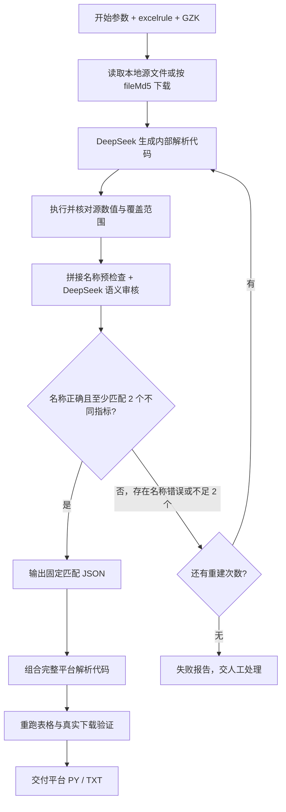

# Excel Match Agent

使用你自己的 **DeepSeek / OpenAI 兼容 API**，根据 Excel 源文件和解析 Skill 生成 Python 解析代码，执行后审核指标名称，与 GZK 规则库匹配，并导出自动工作流可直接使用的 JSON 和完整平台解析代码。

默认纯 Python 运行，支持 VS Code。Docker 仅为可选执行后端。项目本身是 Agent，`skills/excel-rule-codegen` 是 Agent 交给模型的解析规范。

## 工作流程



实现中平台验证位于最终成功输出之前：验证失败时不会将候选匹配结果导出为成功结果。

- excelrule 只提供两项业务规则：**指标名称示例、指标名称取值逻辑**；路径与路径代码仅用于定位。
- 单位及日期的取值逻辑和位置由 DeepSeek 结合实际源表推导。旧模板日期不能覆盖本次源文件。
- 先按拼接表的完整名称预判断，再由 DeepSeek 使用源表标题、父级、表头和 GZK 审核；同一指标最终采用 **GZK 原名**。
- 单位与真实频率辅助判断。同量纲可换算单位不阻止匹配，Agent 不执行单位换算。
- **没有 80% 匹配率门槛**。无待修复名称问题且至少匹配两个不同编码即可输出。
- 首次生成后最多重建 **2 次**；仍未通过则输出人工处理报告。GZK 为空直接停止。
- 源数值、有效零和要求的源单元格必须保留，不为提高比例删数据或强配名称。

## 快速开始

需要 Python 3.10+。以下以 Windows PowerShell 为例：

```powershell
python -m venv .venv
.\.venv\Scripts\Activate.ps1
python -m pip install -e ".[xls]"
Copy-Item .env.example .env
```

编辑本机 `.env`：

```dotenv
DEEPSEEK_API_KEY=填写你的平台Key
DEEPSEEK_API_KEY_ENV=DEEPSEEK_API_KEY
DEEPSEEK_BASE_URL=填写兼容接口的BaseURL
DEEPSEEK_MODEL=填写接口实际支持的模型ID
```

程序自动添加 `Authorization: Bearer ...`。Key 和 Bearer Token 在这个接入方式下使用同一个值，不需要另填一份 Token。`.env` 被 Git 忽略，项目只分发没有真实值的 `.env.example`。

使用 Linux/macOS 时将激活命令改为 `source .venv/bin/activate`。只处理 xlsx/csv 可使用 `pip install -e .`；`xlrd` 仅在处理旧 xls 时需要。

检查配置，不生成代码：

```powershell
python -m excel_match_agent doctor --job examples/job.local.json
```

显式加 `--probe` 才会查询模型列表。运行合成示例会调用你配置的真实模型：

```powershell
python -m excel_match_agent run --job examples/job.local.json
```

示例只含虚构指标、CSV 和合成规则表，不含任何真实业务文件。成功时 stdout 是业务 JSON，执行阶段日志写入 stderr。

## 运行你的任务

```powershell
Copy-Item examples/job.platform.json examples/job.private.json
# 修改 job.private.json 的源标识、路径、GZK、规则表和下载地址
python -m excel_match_agent run --job examples/job.private.json
```

`*.private.json` 和 `private/` 均被 Git 忽略。job 中的相对文件路径以该 job 文件所在目录为基准。

| 配置项 | 用途 |
| --- | --- |
| `fileMd5` / `filemd5` | Excel 原文件标识；不使用 parseFileMd5 或 markdownMD5 替代 |
| `pageTitle` / `pagetitle` | 定位 excelrule 的路径 |
| `source_path` | 可选本机源文件；为空时按 fileMd5 下载 |
| `download_base_url` | 你的文件服务地址，后面会追加 `/fileMd5`；仓库中的 example.invalid 必须替换 |
| `gzk_file` | GZKJG JSON 文件路径 |
| `excelrule_path` | 本机 excelrule 表路径 |
| `name_reference_path` | 可选拼接表路径，按数据源路径代码选工作表；默认完整名称在 K 列 |
| `skill_path` | 解析 Skill；模板已指向随项目分发的 Skill |
| `upstream_metadata` | 开始节点参数，可包含 title、publictime；发布时间不是统计期间 |
| `required_source_cells` | 可选已确认的源数值坐标，用于防止重建时漏提 |
| `export_platform_parser` | 导出可独立使用的平台代码 |
| `platform_verify_download` | 导出时用 fileMd5 实际下载并复测；平台模板默认开启 |

模型配置可放 `.env`，也可通过 job 的 `deepseek` 对象指定地址、模型和认证变量名。job 配置优先；不回退到其他模型提供商。

GZK 支持上游 `rule_*` JSON，也兼容旧字段，参见 [输入输出约定](docs/contracts.md)。API Key 不要写进 job。

## 你会得到什么

每次运行创建独立 `runs/<run_id>/`：

```text
runs/<run_id>/
├── input-context.json            # 本次源表、Skill、规则及元数据快照
├── attempt-1/
│   ├── parser.py                 # DeepSeek 生成的内部核心
│   ├── ExcelData.json
│   ├── derived-rules.json
│   └── name-review/              # 分批名称审核和模型来源
├── node-output.json              # 固定匹配节点 JSON，仅成功时存在
├── run-result.json               # 状态、指标数、重建次数和阶段耗时
└── platform/
    ├── platform-parser.py        # 自动工作流使用这个完整文件
    ├── platform-parser.txt       # 同内容，便于复制
    ├── download-output.json
    └── platform-validation.json
```

平台节点应复制 **platform-parser.txt 全部内容**。内部 `attempt-N/parser.py` 仅接受 `workbook.sheets`，不能单独放到只传 fileMd5 的平台节点。完整平台文件会自动下载并读取源文件，调用逐字保留的内部核心，返回 `code/msg/ExcelData`；沿用 `ExcelData → excel_data` 的节点映射。

最终匹配 JSON 的根字段固定为 `unitArray`、`codeOutputResult`、`OUTDATA`。整数 `indicator_data` 保持 JSON 数字，小数在输出层转为字符串，其他既有数值字符串不擅自改写。

## 测试与隐私检查

以下检查不需要模型 Key，也不调用真实业务 API：

```powershell
python -X utf8 -m unittest discover -s excel_match_agent/tests -q
python -X utf8 scripts/check_release.py
```

GitHub Actions 在 Windows 和 Linux 上运行离线测试。测试中的认证值均为合成占位值。

真实运行记录可能包含源表、GZK 和模型请求上下文，因此 `runs/`、`jobs/`、`.env`、真实数据和日志不纳入仓库。详见 [隐私与配置](SECURITY.md)。当前仓库未指定开源许可证。

## 范围与运行限制

这是本地命令行 Agent，尚未提供 HTTP 服务或上游规则库查询 API；GZK 需要外部工作流提供。模型生成和语义审核由你的 API 完成，下载、执行、匹配和校验由 Python 完成。

默认 `total_timeout=null`，不设整体 120 秒限制；模型、下载、内部解析及平台测试各有独立超时。耗时取决于模型与源表，记录在运行报告中。普通 Python 子进程和 AST 白名单不是操作系统级沙箱；Docker 是内部解析的可选隔离后端，平台真实下载测试使用单独的本地进程且不继承模型 Key。

更多说明：[输入输出约定](docs/contracts.md) · [排障](docs/troubleshooting.md) · [开发说明](CONTRIBUTING.md)
