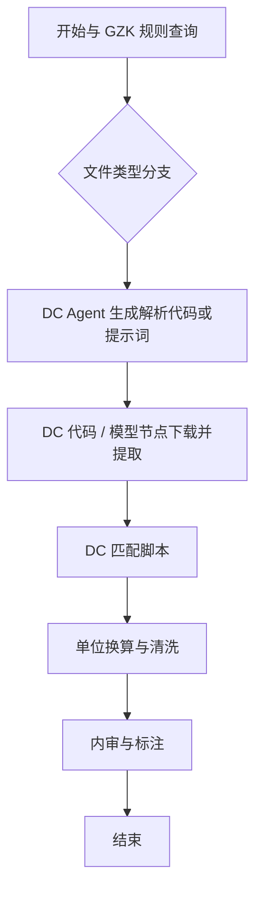
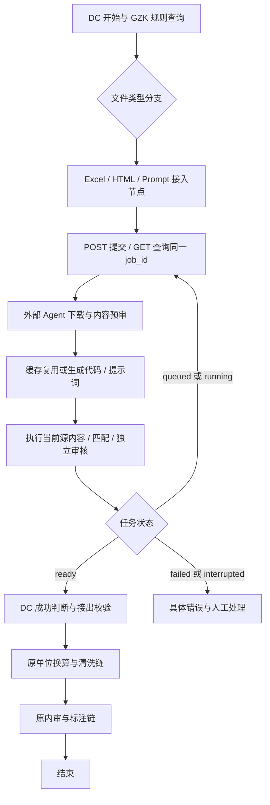

# DC 工作流改造前后对比

本次改造将下载、解析资产生成、执行、指标匹配和名称证据审核迁入外部 Agent 服务；DC 继续负责业务编排、规则库查询和后续单位换算、清洗、内审与标注。

节点与连线数量取自用户提供的两版工作流对比快照，不代表实时读取平台所得。以下按职责归类展示节点变更，不以职责条目数推算逐节点增删数量；实际平台配置以对应导出为准。环境中的工作流 ID 和实例名称不纳入分发文档。

## 1. 改造概览

| 对比项 | 原方案 | 新方案 |
| --- | --- | --- |
| DC 节点数 | 47 | 45 |
| DC 连线数 | 59 | 60 |
| 代码 / 提示词生成 | DC 内置 Agent 节点 | 外部 DeepSeek Agent 服务 |
| 下载与执行 | DC 执行环境中的解析 / 模型节点 | 外部 Agent 的下载器与执行器 |
| 指标匹配与名称审核 | DC 匹配脚本及分散的节点逻辑 | 外部统一匹配、源文证据审核和限次修复 |
| DC 的接入职责 | 组织生成、执行及匹配链 | 3 个分支接入节点、1 个成功判断、2 个接出节点 |
| 后续业务链 | 单位换算、清洗、内审、标注 | 保留原有后处理逻辑，通过字段适配衔接 |
| 规则与生成规范迭代 | 与节点脚本存在耦合 | 集中更新服务侧规则表与 Skill |

节点总数减少 2 个、连线增加 1 条。改造重点是职责迁移与接口统一；这些数量不能直接证明耗时、模型成本或业务准确率提升。

## 2. 架构与数据流

### 改造前：生成、执行与匹配位于 DC



在本次部署场景中，DC 执行环境到目标文件库或模型服务的访问受网络配置约束，下载与模型调用故障较难与业务解析错误区分。规则生成、文件类型适配和审核逻辑分散在工作流节点中，迭代需要同时维护多条分支。容器隔离本身不意味着所有内网访问必然失败，需分别检查实际路由和访问权限。

### 改造后：外部 Agent 处理，DC 编排与接出



图中“执行当前源内容”对 Excel/HTML 表示执行解析 Python，对 Prompt 表示调用配置的模型提取；单元格坐标核对属于 Excel 分支，HTML/Prompt 使用正文证据审核。

DC 接入节点发送业务入参，接收 HTTP 的 `result` 与 `asset`，再包装成 `agent[0].result_json` 及独立资产字段。`result_json` 是 DC 适配字段，并非 HTTP 服务顶层返回字段。

## 3. 节点变更清单

### 新增接入与接出职责

| 节点 | 主要输入 | 主要输出 / 职责 |
| --- | --- | --- |
| Excel 外部 Agent 接入 | fileMd5、pageTitle、真实 fileType、title、publictime、GZKJG | 提交 / 查询任务，输出 agent 数组 |
| HTML 外部 Agent 接入 | markdownMD5、pageTitle、真实 fileType、title、publictime、GZKJG | 同上；正文按 markdownMD5 获取 |
| PDF / Prompt 外部 Agent 接入 | markdownMD5、pageTitle、真实 fileType、title、publictime、GZKJG | 同上；资产字段为 PromptCode / PromptFile |
| Agent 成功判断 | agent[0].status | 仅 ready 进入交付；等待状态继续查询，终止失败展示原因 |
| Excel / HTML 匹配结果接出 | agent；table_audit 模式另需本次 GZKJG | 校验资产，输出 OUTDATA、unitArray、codeOutputResult、excel_data |
| Prompt 匹配结果接出 | agent；platform_chain="md_array" | 输出 OUTDATA，并按原 MD 链整理 unitArray，不要求 excel_data |

所有分支重试查询都可传顶层 `job_id`，或沿用 `agent[0].job_id`；不是只有 HTML / Prompt 才能查询。PromptFile / PromptCode 位于 agent 项中，不能假定它们自动成为顶层输出。

### 被替换或绕过的原职责

| 原节点 / 职责 | 迁移到外部服务后的处理 |
| --- | --- |
| 三分支 DC 内置 Agent 生成 | DeepSeek 按 Skill 和当前源证据生成资产 |
| file_extract 大模型提取 | Prompt 分支在外部服务中执行和审核 |
| DC 内执行 Excel PythonCode | 外部执行器读取真实工作簿，保留源坐标证据 |
| DC 内执行 HTML PythonCode | 外部执行器解析 Markdown，导出完整平台资产 |
| ExcelData 与 GZKJG 本地匹配脚本 | 统一精确匹配、指标身份判断及独立名称审核 |

以上为按职责合并的清单，未虚构原始节点 ID、单个脚本字节数或缺失的逐节点账目。

### 保留的业务职责

- GZK 规则库查询及 GZKJG 数组整理。
- 原有单位换算与精度处理。
- OUTDATA 清洗过滤。
- 内审、警告数据与标注任务。
- 原有结束与后续业务输出。

“保留”指这些业务逻辑和处理链继续使用；接出字段映射、分支条件与数据连接仍需对齐新接口，不能直接省略适配。

## 4. HTTP 接口与 DC 包装

### 提交任务

```http
POST /v1/match/jobs
Authorization: Bearer <SERVICE_TOKEN>
Content-Type: application/json
```

合成结构示例（替换源标识和规则后使用）：

```json
{
  "pageTitle": "演示来源\\统计信息",
  "fileType": "xlsx",
  "fileMd5": "REPLACE_WITH_SOURCE_FILE_ID",
  "title": "REPLACE_WITH_ACTUAL_SOURCE_TITLE",
  "publictime": "",
  "workflow_run_id": "REPLACE_WITH_STABLE_RUN_ID",
  "GZKJG": [
    {"rule_indicator_code": "1", "rule_indicator_name": "合成甲累计", "rule_constant_name": "万元", "rule_unit_ratio": "", "indicator_release_frequency": "月"},
    {"rule_indicator_code": "2", "rule_indicator_name": "合成乙累计", "rule_constant_name": "万元", "rule_unit_ratio": "", "indicator_release_frequency": "月"}
  ]
}
```

HTML / Prompt 改用真实 `fileType` 和对应 `markdownMD5`；PDF、Word 和图片须由上游先完成正文转换，Agent 不在此接口中负责 OCR。服务可从 `GZK.GZKJG` 接受同样规则。

提交返回 `job_id` 与当前状态；首次受理通常为 HTTP 202，幂等复用通常为 HTTP 200。服务令牌与 DeepSeek Key 分开，模型 Key 不填写到 DC。

### 查询与交付

```http
GET /v1/match/jobs/{job_id}?wait_seconds=25
Authorization: Bearer <SERVICE_TOKEN>
```

`wait_seconds` 范围为 0～25 秒，只控制本次长轮询的等待时间。状态包括 queued、running、ready、failed、interrupted。

| ready 响应字段 | 含义 |
| --- | --- |
| job_id、status、parse_strategy、elapsed_seconds | 任务身份、分支、结果状态及总耗时 |
| result | 匹配业务结果；三分支字段见下表 |
| asset.type | python 或 prompt |
| asset.filename | 按完整来源路径命名的 .py 或 .md 文件名 |
| asset.content | 已审核的完整代码或提示词 |
| asset.sha256 | 交付资产 UTF-8 内容哈希 |
| result._asset_transfer | 传输用备份，含任务身份与 Base64 内容；接出校验后移除 |

失败响应包含具体 `error.code`、中文 `error.message`、阶段和建议；不能把部分候选数据当作 ready 交付。详细定义见 [HTTP 服务指南](http-service.md) 与 [输出契约](contracts.md)。

## 5. 三分支路由与接出

| 真实 fileType | 正文标识 | parse_strategy | agent 资产字段 | 本次保留业务链的适配模式 |
| --- | --- | --- | --- | --- |
| xlsx / xls / csv | fileMd5 | excel | PythonCode / PythonFile | table_audit |
| html / htm / shtml | markdownMD5 | html | PythonCode / PythonFile | table_audit |
| pdf / md / markdown / txt / doc / docx / png / jpg / jpeg | markdownMD5 | prompt | PromptCode / PromptFile | md_array |

`profiles` 是服务端分支到任务配置文件的映射，不要求使用某个固定文件名。不要传 `fileType="prompt"`。`platform_chain` 是 DC 接出节点参数，不是 HTTP 提交字段；不接原业务适配链时可保留默认 core。

- Excel / HTML：HTTP result 为 OUTDATA、unitArray、codeOutputResult 和原始 excel_data；table_audit 依据本次 GZK 补齐频率。
- Prompt：HTTP 业务 result 只有 OUTDATA；md_array 接出时额外整理 unitArray，换算比例留给后续清洗节点。Prompt 不使用 table_audit，不要求 excel_data。
- 统一接出脚本通过 **parse_strategy** 判断业务契约，通过 **platform_chain** 选择后处理适配。部署时可以保留两个独立接出节点，但它们使用同一份最新版脚本。
- OUTDATA 映射下游 out_data；Excel / HTML 的 excel_data 保留原始数值与单位，不能用换算后的 out_data 覆盖。
- 接出保留历史字段 python_code / python_file；Prompt 分支下其中是提示词及 .md 文件名，不能当 Python 执行。

## 6. 关键设计决策

1. **异步受理与 job_id 轮询**：模型生成、提取、审核及修复可能超过单次 DC 节点等待时间，不承诺固定 30～200 秒完成。DC_AGENT_RETRY 表示需继续查询同一任务；能否自动重试取决于 DC 节点的重试配置，代码异常本身不会自动恢复。也可配置 PENDING_MODE="return" 并显式连接等待 / 查询分支。
2. **SHA256 与传输备份**：确认交付内容与服务端审核通过的资产一致，并检测字段丢失、换行变化或内容改动。哈希用于完整性校验，不替代身份认证或 HTTPS；Base64 只是编码，不是加密。缺失字段可按绑定的任务备份恢复，篡改的非空字段不能静默替换。
3. **保留原后处理链**：单位换算、清洗、内审及标注继续由既有节点负责，Agent 不提前换算数值，避免重复处理。业务处理链保留，接出字段及数据连接按当前契约适配。
4. **统一接出与分支契约**：三分支共用接入、接出实现；parse_strategy 保留各自业务结构，platform_chain 适配原有业务链，避免为每种文件重新维护一套结果解析代码。

此外，同路径新文件优先复用已经审核的代码或提示词，减少重复生成造成的 Token 成本。缓存不复用旧数值，当前源文件仍需预审、执行和审核；Prompt 的模型提取仍有调用成本。详见 [缓存与质量门禁](cache-and-quality.md)。

## 7. 验证范围

节点统计和保留清单来自提供的工作流快照；HTTP 字段、轮询和接出逻辑已按本仓库当前实现核对。该文档不代表对两版全部 DC 节点重新进行过端到端实测，也不据此声称处理时间或成本下降比例。

本次文档整理保留原始本机文档，未上传真实业务文件、服务凭据、完整平台工作流导出或任务运行记录。
